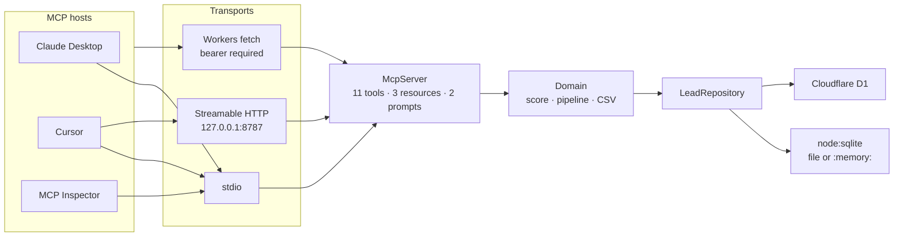

# LeadFlow MCP

An MCP server that lets an AI assistant run the front desk for a one-shop service business: capture a lead, score it with a published rubric, chase the follow-up, and read the pipeline.

Built for Claude Desktop, Cursor, and any other Model Context Protocol client. SQLite on disk. No paid API, no account, no network call on the tool path.

[](https://github.com/kfairy9999/leadflow-mcp/actions/workflows/ci.yml)
[](LICENSE)
[](https://nodejs.org/)
[](https://github.com/modelcontextprotocol/typescript-sdk)

This is a portfolio project. The seed data is fictional. Nothing here is deployed, and the README does not claim users or production traffic. The numbers below are from a local run on Node v22.23.4.

## Demo

`npm run demo` opens an in-process MCP client against a seeded database with the clock pinned to `2026-11-18T15:00:00.000Z`. The transcript below is that session. The only edit is the generated lead id, which is a random 16 hex characters and is written as `lead_<generated>` so the file stays stable. `test/demo.test.ts` fails if a later run disagrees.

```text
LeadFlow MCP  ·  Northglass Plumbing, Harborton (fictional)
clock 2026-11-18T15:00:00.000Z  ·  in-process MCP client, seeded SQLite

$ tools/list
create_lead  update_lead  get_lead  search_leads  score_lead  log_interaction  schedule_follow_up  set_follow_up_status  list_due_follow_ups  pipeline_summary  export_leads_csv

$ pipeline_summary {}
Pipeline as of 2026-11-18T15:00:00.000Z
Open: 8 · Won: 1 · Lost: 1 · Win rate: 1/2 (50.0%)
Open value: $21,050.00
Stages: new 2, contacted 2, qualified 1, proposal 3, won 1, lost 1
Stale (>7d): 2
- lead_samira_adeyemi · Samira Adeyemi · contacted · Water heater flush · 18d quiet
- lead_rowan_blake · Rowan Blake · qualified · Outdoor faucet winterize · 8d quiet

$ list_due_follow_ups {}
3 follow-ups due as of 2026-11-18T15:00:00.000Z
- fu_priya_nandakumar · Priya Nandakumar · lead_priya_nandakumar · due 2026-11-17T13:00:00.000Z · Main line is still unanswered.
- fu_marina_cho · Marina Cho · lead_marina_cho · due 2026-11-18T13:00:00.000Z · Confirm the tankless install window.
- fu_luis_ortega · Luis Ortega · lead_luis_ortega · due 2026-11-18T14:30:00.000Z · Call back about the no-hot-water emergency.

$ score_lead {"leadId":"lead_marina_cho"}
lead_marina_cho · Marina Cho · proposal · 100/100 hot · $4,800.00 · Tankless water heater install
Hot follow-up priority, 100/100. Strongest signal: Referral is the strongest source in this rubric.
+22 source — Referral is the strongest source in this rubric.
+10 phone — A phone number is on file.
+8 email — An email address is on file.
+20 urgency — Urgency is high.
+12 value — Estimated value is $1,500 to $4,999.99.
+16 stage — Stage is proposal. Closest open stage to a decision.
+16 recency — Last activity was under 2 days ago.
-4 cap — The raw total exceeded 100, so the published ceiling was applied.
= 100

$ score_lead {"leadId":"lead_samira_adeyemi"}
lead_samira_adeyemi · Samira Adeyemi · contacted · 27/100 cool · $220.00 · Water heater flush
Cool follow-up priority, 27/100. Strongest signal: Website lead. Ahead of a cold inquiry, behind a referral.
+14 source — Website lead. Ahead of a cold inquiry, behind a referral.
+8 email — An email address is on file.
+6 urgency — Urgency is normal.
+4 value — Estimated value is under $400.
+7 stage — Stage is contacted. A conversation has started.
-12 recency — No activity for 18 days. Open leads go quiet after 14 days.
= 27
```

The rest of the session creates a lead twice with the same idempotency key. The second call returns `Replay: yes, existing lead returned` and the same id. Full text: [`docs/demo-transcript.txt`](docs/demo-transcript.txt).

## Quickstart

Node.js **22.13 or newer**. `node:sqlite` ships in that runtime. Node 20 cannot run this project.

```bash
git clone https://github.com/kfairy9999/leadflow-mcp.git
cd leadflow-mcp
npm install
npm test
npm run build
npm run demo
```

Talk to it from MCP Inspector (stdio, the path the integration test also drives):

```bash
npx @modelcontextprotocol/inspector -- node dist/bin/stdio.js
```

Inspector opens a browser. Choose **Connect**, then **Tools**, then `pipeline_summary`, and run it with empty arguments. The seed loads itself the first time the database file is empty.

A loopback HTTP server is the same process with a different entry:

```bash
npm run dev:http
# listens on http://127.0.0.1:8787/mcp
# health:  curl -s http://127.0.0.1:8787/health
```

## Architecture



The host owns the model. LeadFlow owns the books. A tool call is validated by Zod before the handler runs, the handler talks only to `LeadRepository`, and the repository talks to a small SQL interface. `node:sqlite` implements that interface for the laptop. The D1 adapter implements it for the Worker. The scoring function is pure: same lead, same clock, same score, and the factors sum to the number you see.

## Tools

Money is integer cents. `480000` is $4,800.00. Scores are computed on read, so a rubric change applies to old leads without a migration.

| Tool                   | What it does                                                                                                                                                                      |
| ---------------------- | --------------------------------------------------------------------------------------------------------------------------------------------------------------------------------- |
| `create_lead`          | Insert a lead. Optional `idempotencyKey`. A retry with the same key and payload returns the original lead. A different payload with that key is a conflict.                       |
| `update_lead`          | Patch one lead. `null` clears phone, email, city, or notes. `expectedUpdatedAt` rejects a write if someone else saved first.                                                      |
| `get_lead`             | One lead, its score, interactions, and follow-ups.                                                                                                                                |
| `search_leads`         | ASCII case-insensitive match on name, service, city, email, phone, and notes. Ranked inside the 500 most recently updated matches. `truncated: true` when the scan hits that cap. |
| `score_lead`           | The published rubric, factor by factor. Does not persist and does not call a model.                                                                                               |
| `log_interaction`      | Call, email, SMS, visit, or note. Optional idempotency key. An omitted `occurredAt` uses the server clock and is left out of the hash, so a retry does not conflict with itself.  |
| `schedule_follow_up`   | A due time, including a time in the past. Past items show up as due immediately.                                                                                                  |
| `set_follow_up_status` | `scheduled`, `done`, or `cancelled`. Done and cancelled leave the due list. Setting the same status again is safe.                                                                |
| `list_due_follow_ups`  | Scheduled items with `dueAt` at or before the clock. The call list.                                                                                                               |
| `pipeline_summary`     | Stage counts, open value, win rate `won / (won + lost)`, and open leads quiet for `staleAfterDays` (default 7). Win rate is null when nothing has closed.                         |
| `export_leads_csv`     | CSV, RFC 4180 quoting, and a leading apostrophe on cells that start with `=`, `+`, `-`, or `@`. Caps at 5,000 rows.                                                               |

Read tools set `readOnlyHint` and `idempotentHint`. Writes set `openWorldHint: false` because the server does not call the network.

Validation failures come back as tool results with `isError: true` and the Zod message, so the model can correct the argument. Missing rows come back as `NOT_FOUND`. Idempotency mismatches come back as `CONFLICT`. An unexpected throw is logged by error name only and returned as `INTERNAL`.

## Resources and prompts

| URI or name                 | Kind              | Body                                                                                 |
| --------------------------- | ----------------- | ------------------------------------------------------------------------------------ |
| `leadflow://pipeline`       | resource          | JSON snapshot: stages, win rate, open value, stale leads.                            |
| `leadflow://scoring-model`  | resource          | Markdown rubric. Generated from `SCORE_RULES`, the same object `score_lead` uses.    |
| `leadflow://leads/{leadId}` | resource template | JSON for one lead. The list callback publishes the 100 most recently updated leads.  |
| `daily_follow_up_briefing`  | prompt            | Embeds the live pipeline and the due list. Tells the model to use only those facts.  |
| `draft_follow_up`           | prompt            | One lead, one channel. Tells the model not to invent a price, a discount, or a time. |

## Configuration

| Variable              | Default                  | Meaning                                                                                                                 |
| --------------------- | ------------------------ | ----------------------------------------------------------------------------------------------------------------------- |
| `LEADFLOW_DB`         | `./data/leadflow.sqlite` | SQLite path, or `:memory:`.                                                                                             |
| `LEADFLOW_SEED`       | `auto`                   | `auto` seeds an empty database. `always` wipes and reseeds (Node only; the Worker ignores it). `never` leaves it empty. |
| `LEADFLOW_LOG_LEVEL`  | `info`                   | `debug`, `info`, `warn`, `error`. JSON lines on stderr.                                                                 |
| `LEADFLOW_HTTP_HOST`  | `127.0.0.1`              | Bind address. Any non-loopback host requires `LEADFLOW_AUTH_TOKEN`.                                                     |
| `LEADFLOW_HTTP_PORT`  | `8787`                   | HTTP port. `0` picks a free port.                                                                                       |
| `LEADFLOW_STALE_DAYS` | `7`                      | Quiet-open-lead window, 1–90.                                                                                           |
| `LEADFLOW_NOW`        | unset                    | Pins the clock. For demos and tests. Leave it unset on a real desk.                                                     |
| `LEADFLOW_AUTH_TOKEN` | unset                    | Bearer token, at least 16 characters. Required off loopback and on the Worker.                                          |

Logs go to stderr. stdout is the stdio protocol and is left alone. The logger redacts emails, phone-shaped strings, bearer tokens, and fields named `email`, `phone`, `notes`, `summary`, `contactName`, and similar. The database file itself holds whatever you typed into a lead. Treat `data/` as private. It is gitignored.

The seed is Northglass Plumbing in the invented town of Harborton. Ten people, `555-0100` phone numbers, `example.com` mailboxes. See `src/db/seed.ts`.

## Claude Desktop and Cursor

Stdio, after `npm run build`. Replace the path.

```json
{
  "mcpServers": {
    "leadflow": {
      "command": "node",
      "args": ["/absolute/path/to/leadflow-mcp/dist/bin/stdio.js"],
      "env": {
        "LEADFLOW_DB": "/absolute/path/to/leadflow-mcp/data/leadflow.sqlite"
      }
    }
  }
}
```

Claude Desktop reads that object from `claude_desktop_config.json`. Cursor reads the same `mcpServers` object from its MCP settings. Restart the host after saving. The first session creates the SQLite file and, because `LEADFLOW_SEED` defaults to `auto`, loads the fictional shop when the file is empty.

For the loopback HTTP server, point the host at `http://127.0.0.1:8787/mcp`. The process refuses to bind a non-loopback address unless `LEADFLOW_AUTH_TOKEN` is set, and `/mcp` then requires `Authorization: Bearer <token>`.

## MCP Inspector

1. `npm run build`
2. `npx @modelcontextprotocol/inspector -- node dist/bin/stdio.js`
3. Connect.
4. **Tools → `list_due_follow_ups` → Run.** Three fictional follow-ups come back when the clock is "now" after the seed's due times. With a fresh database and no `LEADFLOW_NOW`, the seed is stamped at process start, so Marina, Priya, and Luis are already due.
5. **Tools → `score_lead`**, argument `{"leadId":"lead_marina_cho"}`. The factors sum to the score, including the ceiling adjustment.
6. **Resources → `leadflow://scoring-model`.** The point values match the tool.
7. **Prompts → `daily_follow_up_briefing`.** The message contains the pipeline JSON and an instruction not to invent prices.

Inspector launches the command you give it. If Connect fails, the usual cause is a Node older than 22.13, or a `console.log` on stdout. This server logs with the structured logger on stderr.

## Design decisions

**SDK v2.** `@modelcontextprotocol/server` 2.4.0, `@modelcontextprotocol/client` 2.4.0, and `@modelcontextprotocol/node` 2.1.2. That is the current stable TypeScript SDK line (protocol revision 2026-07-28). The v1 package `@modelcontextprotocol/sdk` still publishes, and it is the one a lot of older posts show. v2 is what `npm install @modelcontextprotocol/server` resolves to, and its `createMcpHandler` / `serveStdio` split is the supported way to share one factory across stdio and HTTP.

**Node 22.13 and `node:sqlite`.** The brief allowed Node 20 or newer. This repo requires 22.13 because that is the release where `node:sqlite` no longer needs a flag. The module is still marked experimental on Node 22 (release candidate on newer lines). The driver silences that one warning. The SQL is tables, indexes, foreign keys, and `?` parameters. A native driver such as `better-sqlite3` would have pulled a C toolchain into `npm install`, which fights the "clone and test" requirement. The repository interface is the exit if the built-in API moves: `DatabaseSync` is called out in `src/db/node-sqlite.ts` because newer Node versions renamed the class and kept the old name as an alias.

**One SQL dialect, two drivers.** Migrations are `IF NOT EXISTS` strings. Wrangler applies `migrations/0001_init.sql`. Node and the Worker apply the same text embedded in `src/db/migrations.ts`. A unit test fails if the file and the string diverge. D1 has no interactive transaction, so the adapter buffers the writes inside `transaction()` and sends one `batch()`. Reads in that callback see committed rows only. Idempotency does not need read-your-writes: the insert of the row and the insert of the key share a batch, the key is a primary key, and a loser of a race catches the unique violation and returns the winner. That race is tested with `Promise.all` on both drivers.

**Scores are not stored.** A lead's priority is a function of the row, the latest interaction, and the clock. Persisting it would freeze a rubric the day the lead was saved. `minScore` and `sort: score` run in memory over the 500 most recently updated matches, and the tool says `truncated` when that window is full. A shop of this size does not have a warehouse of leads. The cap is there so a runaway import cannot sort the whole table on every keystroke.

**The rubric is the documentation.** `SCORE_RULES` is the only copy of the points. `renderScoringModel()` prints it. Lost leads cap at 15 and won leads cap at 40 so a closed job cannot sit at the top of a chase list. The factor list includes the cap line, and the sum of the factors is the score. Marina Cho at the pinned clock is 104 before the ceiling and **100** after. Samira Adeyemi is **27**. Those two are pinned in tests.

**Cents, not floats.** Currency math stays integer. The CSV column is `estimated_value_cents`.

**Auth matches the bind.** Loopback HTTP checks the `Host` and `Origin` headers with the SDK's localhost guards, which is the DNS-rebinding control the SDK docs ask for. A non-loopback bind without a token is refused at startup. The Worker returns 503 for `/mcp` until `LEADFLOW_AUTH_TOKEN` is at least 16 characters, then requires a bearer token compared in constant time. `GET /health` returns `{ ok: true }` and no lead data. `LEADFLOW_SEED=always` is ignored on the Worker so a request cannot wipe the database.

**Logging.** Tool success logs the tool name and duration. It does not log the argument object. An integration test creates `demo.replay@example.com` and asserts the log sink does not contain that address.

## Testing

`npm test` is Vitest. The suite that produced the numbers below is **45 tests**.

| Layer       | What it drives                                                                                                                                                                                                                 |
| ----------- | ------------------------------------------------------------------------------------------------------------------------------------------------------------------------------------------------------------------------------ |
| Unit        | Scoring invariants (factors sum to the score, caps, bands), pipeline math, CSV quoting and formula neutralization, canonical hashing, log redaction, config parsing.                                                           |
| Repository  | The same cases on `node:sqlite` and on a fake D1 that executes the SQL against `node:sqlite` through the D1-shaped `prepare` / `batch` API. Includes the idempotency race, optimistic concurrency, and LIKE-wildcard escaping. |
| MCP client  | `@modelcontextprotocol/client` against `createMcpHandler(...).fetch` in process. Tools, resources, prompts, validation errors, and a missing lead.                                                                             |
| HTTP        | A real `node:http` listen on port 0. Health, 404, a foreign `Host`, a foreign `Origin`, and a client call. Bearer token when configured.                                                                                       |
| stdio       | A spawned `tsx src/bin/stdio.ts`. Asserts the summary and that stderr has no `example.com` and no `555`.                                                                                                                       |
| Worker      | The Workers `fetch` entry with the fake D1. Health is public. `/mcp` is 503 without a token, 401 with the wrong token, and serves the seeded pipeline with the right token.                                                    |
| Demo        | `runDemo()` against `docs/demo-transcript.txt`.                                                                                                                                                                                |
| Build smoke | `scripts/smoke-stdio.mjs` launches `dist/bin/stdio.js` the way CI does.                                                                                                                                                        |

Coverage from `npm run test:coverage` on this tree, V8, including `src/**` and excluding `src/bin/**` (those files are the thin entrypoints the stdio and smoke tests spawn):

|            | Percent | Count     |
| ---------- | ------- | --------- |
| Statements | 90.04%  | 760 / 844 |
| Branches   | 78.02%  | 419 / 537 |
| Functions  | 94.21%  | 228 / 242 |
| Lines      | 91.33%  | 696 / 762 |

Domain lines are 95.53%. The MCP registration file is 95.48% lines. Thresholds in `vitest.config.ts` sit under those figures (88% statements, 74% branches, 90% functions, 88% lines) so a silent drop fails CI without making the gate equal to one run's rounding.

`npm audit --omit=dev` on this lockfile reports no production vulnerabilities. A full `npm audit` reports high advisories in the dev toolchain (Vitest and typescript-eslint, via `picomatch`). They are not in the runtime dependency tree.

## Deploy

There is **no live URL**. This environment has no Cloudflare credentials, and the project does not invent one.

`npx wrangler deploy --dry-run` with Wrangler 4.164.0 did bundle the Worker: upload 752.38 KiB, gzip 154.35 KiB, with the `DB` D1 binding and the `LEADFLOW_SEED` / `LEADFLOW_STALE_DAYS` variables. The dry run stops before any account call.

The Worker entry is `src/worker.ts`. Wrangler 4 is a devDependency (`wrangler` 4.164.0 in the lockfile). `compatibility_date` is `2026-11-18`. D1 is bound as `DB`. `database_id` is omitted so the first authenticated deploy can provision the database, or you can create it yourself and paste the id.

```bash
npx wrangler login
npx wrangler d1 create leadflow
# put the printed database_id on the d1_databases entry in wrangler.jsonc
npx wrangler d1 migrations apply leadflow --remote
npx wrangler secret put LEADFLOW_AUTH_TOKEN
npx wrangler deploy
```

The MCP URL is `https://<your-worker>.workers.dev/mcp`. Clients send `Authorization: Bearer <token>`. Until the secret is set, `/mcp` answers 503 and the database stays closed. The Worker also runs the embedded migration on request, and the SQL is idempotent, so the Wrangler migration and the runtime migration can both apply.

Free tier, as published by Cloudflare: Workers and D1 both have a free allotment. This repo does not measure that allotment and does not depend on a paid Workers feature. If you do not want a Cloudflare account, the supported host is the stdio process on your own machine. That path is the one CI smokes.

## Roadmap

- Optional stage machine, for shops that want a fixed path from `new` through `won` or `lost`.
- Per-user tokens in place of one shared bearer secret.
- CSV import that reuses the create-lead validation.
- A reminder when a follow-up comes due, which needs a host that can receive a notification while the laptop is closed.
- Move the Node floor to a release where `node:sqlite` is stable, and delete the experimental-warning filter, without giving up the zero-compile install.

## Project layout

```text
src/bin/            stdio, HTTP, and seed entrypoints
src/mcp/            tool, resource, and prompt registration
src/domain/         scoring, pipeline, CSV, Zod schemas
src/db/             SQL, migrations, repository, seed, both drivers
src/http/serve.ts   loopback Streamable HTTP
src/worker.ts       Cloudflare Workers fetch handler
migrations/         Wrangler D1 migration, kept equal to the embedded SQL
test/               unit, repository, MCP, HTTP, stdio, worker, demo
scripts/demo.ts     the transcript
scripts/smoke-stdio.mjs
```

Scripts: `dev`, `dev:http`, `build`, `start`, `start:http`, `seed`, `demo`, `test`, `test:coverage`, `lint`, `format`, `typecheck`, `deploy:cf`.

## License

[MIT](LICENSE). Copyright 2026 Kevin Fairley.

## About the author

Kevin Fairley is an AI engineer. Portfolio: [kfairy9999.github.io](https://kfairy9999.github.io). LinkedIn: [kevin-fairley-94330b42a](https://www.linkedin.com/in/kevin-fairley-94330b42a). GitHub: [kfairy9999](https://github.com/kfairy9999).
